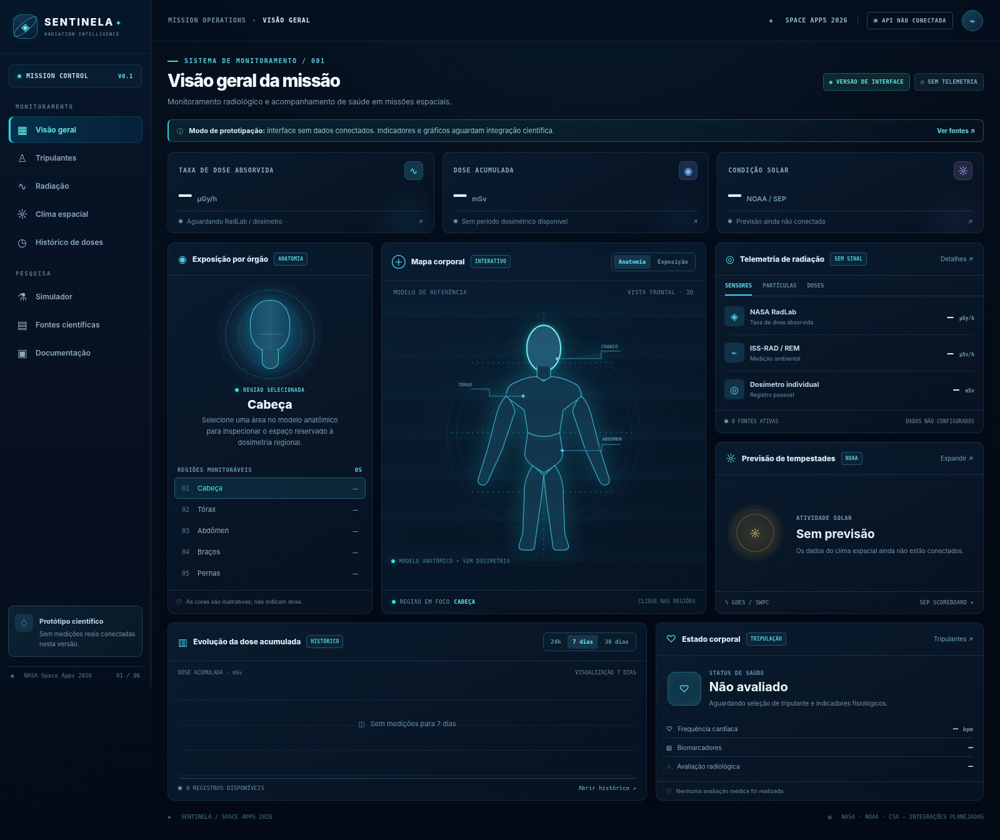

# Radiance

**Context-Aware Radiation Monitoring**

A research prototype developed for the **NASA Space Apps Challenge 2026**, addressing the challenge *Create Health Monitoring Software for Astronauts on Space Missions*.

Radiance brings together space radiation measurements, solar particle observations, scientific forecasts, and contextual evidence in two coordinated interfaces: a web dashboard and a browser-based wearable preview.

The project emphasizes scientific traceability, local data persistence, and clear separation between observed, forecast, and simulated information.



## Quick Start

**Requirements:** Node.js 22.12+, Python 3.10+, Git, and internet access for the initial dependency installation.

### 1. Clone the repository

```powershell
git clone https://github.com/marxz37/Mustach-NASA.git
cd Mustach-NASA
```

### 2. Start the applications

Open three separate terminals in the project root and run:

| Service | Windows command | Address |
|---|---|---|
| Backend | `iniciar-backend.bat` | http://localhost:8000/docs |
| Web dashboard | `iniciar-frontend.bat` | http://localhost:5173 |
| Wearable preview | `iniciar-wearable.bat` | http://localhost:5174 |

The launchers install missing dependencies when necessary. Keep all three terminals open while using Radiance.

### Manual installation

**Backend — terminal 1**

```powershell
cd backend
py -m venv .venv
.\.venv\Scripts\python.exe -m pip install -r requirements-dev.txt
.\.venv\Scripts\python.exe -m uvicorn app.main:app --reload --port 8000
```

**Web — terminal 2**

```powershell
cd frontend
npm ci
npm run dev
```

**Wearable — terminal 3**

```powershell
cd wearable
npm ci
npm run dev
```

## Explore Radiance

Radiance starts in **Simulation** mode, so the project can be demonstrated without downloading scientific records.

1. Open the Web dashboard at http://localhost:5173.
2. Choose one of four scenarios: Normal Conditions, Solar Event Predicted, Event in Progress, or Recovery.
3. Adjust the demonstration speed to 1×, 10×, or 60×. Explore the live charts, accumulated dose, and interactive 2D body map.
4. Open the Wearable at http://localhost:5174. Both applications follow the same simulation scenario through FastAPI.
5. Swipe to see solar activity forecasts and test simulated SEP notifications. Optional browser vibration depends on device support.
6. Explore the Crew section, EVA timer, and pre-EVA evidence review.

### Data modes

| Mode | Description |
|---|---|
| Simulation | Fictional scenarios and astronaut profiles for demonstration |
| Real Data | Previously collected scientific measurements and forecasts |
| No Data | Neutral interface without synthetic or observed readings |

The system never silently replaces missing real measurements with simulated values.

## Scientific Data Sources

Radiance uses publicly accessible scientific services from NASA and NOAA.

| Source | Information used |
|---|---|
| NASA OSDR RadLab | Historical ISS radiation measurements from DosTel1 |
| NOAA GOES/SWPC | Observed solar proton flux, three-day event probabilities, and official bulletins |
| NASA CCMC SEP Scoreboard | HESPERIA REleASE solar energetic particle forecasts |
| NASA DONKI | Historical solar energetic particle events |

These services provide different scientific quantities. Solar proton flux is not an astronaut's personal radiation dose, and environmental measurements cannot automatically determine organ exposure or medical risk.

The NASA Human Research Program, NASA OSDR biological studies, and Canadian Space Agency dosimetry experiments also provide research foundations, but they are not live clinical data sources in this prototype.

For exact endpoints, instruments, units, dates, and reproducible samples, see [Scientific Data Used](docs/DADOS-NASA-UTILIZADOS.md).

## Collect Real Scientific Data

Data collection is **manual**, not automatically scheduled.

From the `backend` directory:

```powershell
.\.venv\Scripts\python.exe -m app.collect radlab
.\.venv\Scripts\python.exe -m app.collect goes
.\.venv\Scripts\python.exe -m app.collect noaa-forecast
.\.venv\Scripts\python.exe -m app.collect noaa-alerts
.\.venv\Scripts\python.exe -m app.collect ccmc
.\.venv\Scripts\python.exe -m app.collect donki --start 2024-05-09 --end 2024-05-13
```

Alternatively, run all collectors:

```powershell
.\.venv\Scripts\python.exe -m app.collect all
```

Records are validated and stored in SQLite. Collection attempts and failures are logged.

A fresh repository clone begins without pre-collected scientific measurements.

The RadLab historical sample can be explored using the interval **April 1, 2022, 23:00–23:20 UTC** in the instrumental history view.

API documentation: http://localhost:8000/docs

## Architecture

```text
Scientific Sources
NASA RadLab · NOAA SWPC · NASA CCMC · NASA DONKI
                      |
                      v
                Python / FastAPI
                      |
                      v
                 SQLite Database
                      |
            +---------+---------+
            |                   |
            v                   v
       Radiance Web       Radiance Wearable
       React + Vite       React + Vite
```

Both applications consume the same FastAPI backend.

The shared demonstration timeline is also maintained by FastAPI, avoiding conflicting simulations between Web and Wearable.

### Technology Stack

| Area | Technologies |
|---|---|
| Frontend | React, TypeScript, Vite |
| UI | Tailwind CSS, custom components, Lucide React |
| Charts | Apache ECharts |
| Data fetching | TanStack Query, Fetch |
| Backend | Python, FastAPI, Pydantic |
| Database | SQLite |
| Testing | Vitest, Pytest, Playwright |
| CI/CD checks | GitHub Actions |
| Languages | English, Portuguese, Spanish |

## Offline Functionality

SQLite stores scientific observations, forecasts, alerts, events, ingestion results, and demonstration state.

Previously collected records remain available after application restarts.

**Radiance can access stored scientific history without external internet access, provided that the local FastAPI service is running.**

If FastAPI is unavailable, the interfaces cannot normally access SQLite or advance the shared simulation.

### Database Backup

From `backend/`:

```powershell
.\.venv\Scripts\python.exe -m app.backup backup ..\radiance-backup.sqlite3
```

To restore a backup, stop FastAPI first:

```powershell
.\.venv\Scripts\python.exe -m app.backup restore ..\radiance-backup.sqlite3 --force
```

## Testing

Run the following commands in each application directory after installing its dependencies.

**Web — `frontend/`**

```powershell
npm run typecheck
npm run lint
npm test
npm run build
npm run test:e2e
```

**Wearable — `wearable/`**

```powershell
npm run typecheck
npm run lint
npm test
npm run build
npm run test:e2e
```

**Backend — `backend/`**

```powershell
.\.venv\Scripts\python.exe -m pytest -q
```

GitHub Actions performs automated builds, linting, and unit tests. Playwright end-to-end tests are executed separately; live HTTP tests require the relevant local services.

## Scientific Limitations

Radiance is a research and demonstration prototype.

- No physical smartwatch or personal dosimeter is connected.
- Fictional astronaut profiles do not represent real individuals.
- The body heatmap uses illustrative colors, not validated organ dosimetry.
- Solar event probabilities do not describe an individual's probability of injury.
- Missing or outdated data never means a safe condition.
- Pre-EVA evidence verification does not authorize an astronaut to perform an EVA.
- Experimental browser vibration does not guarantee compatibility with physical wearable devices.

## Documentation

- [Scientific Data Used](docs/DADOS-NASA-UTILIZADOS.md)
- [Scientific Sources](docs/FONTES-CIENTIFICAS.md)
- [Data Traceability](docs/RASTREABILIDADE-DADOS.md)
- [Scientific Contracts](docs/CONTRATOS.md)
- [Technologies and Architecture](docs/TECNOLOGIAS.md)
- [Design System](docs/DESIGN-SYSTEM.md)
- [Development and Validation Notes](docs/AJUSTES-V2.md)

## AI-Assisted Development

OpenAI Codex assisted with code development, testing, review, and documentation. Fictional astronaut portraits were AI-generated, but the specific image-generation model is not documented.

Scientific observations and forecasts remain attributed to their original sources and are not presented as AI-generated measurements.

---

**Radiance — Context-Aware Radiation Monitoring**

*An independent research prototype developed for the NASA Space Apps Challenge 2026. Use of public NASA and NOAA resources does not imply endorsement by those agencies.*
